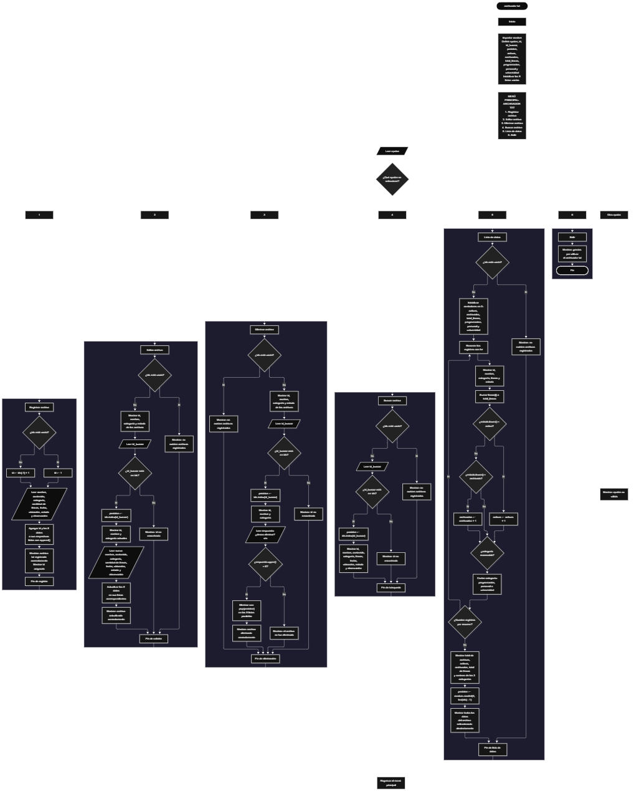

Este proyecto, llamado <b>archivador txt</b>, fue desarrollado en <b>python</b> como un ejercicio práctico para fortalecer la lógica de programación mediante la creación de un sistema de gestión de archivos de texto desde la consola. El programa cuenta con un menú principal de seis opciones que permite <b>registrar, editar, eliminar, buscar y listar información de los archivos</b>, además de finalizar la ejecución. Cada registro almacena información como el nombre del archivo, su contenido, la categoría, la cantidad de líneas, la fecha de creación, la ubicación, el estado y las observaciones. Para organizar estos datos se utilizan nueve listas paralelas, que mantienen la información relacionada mediante una misma posición y un identificador numérico. Durante su desarrollo se aplicaron conceptos fundamentales de programación, como variables, listas, estructuras condicionales, ciclos repetitivos, búsqueda de registros, modificación de datos, eliminación de elementos y cálculo de estadísticas. La información se almacena temporalmente en memoria durante la ejecución, por lo que el programa no crea ni modifica archivos físicos en el sistema de archivos.

<h2 align="center">⚙️ Funcionamiento del menú principal</h2>

### ➕ Registrar archivo

La opción <b>1) registrar archivo</b> permite incorporar un nuevo registro al archivador. Para comenzar, el programa comprueba si la lista <b>ids</b> está vacía. Si no contiene registros, asigna el identificador inicial <b>1</b>; de lo contrario, genera el siguiente identificador sumando uno al último valor almacenado en la lista. Después, solicita el <b>nombre del archivo con extensión .txt, el contenido, la categoría, la cantidad de líneas, la fecha de creación, la ubicación o carpeta, el estado y la observación</b>. La cantidad de líneas se convierte a un valor entero mediante <b>int(input())</b>. A continuación, cada dato se almacena en su respectiva lista mediante la instrucción <b>append()</b>, manteniendo todas las propiedades del registro en la misma posición. Finalmente, muestra el mensaje <b>"archivo txt registrado correctamente."</b> y presenta el identificador asignado. Esta operación guarda la información introducida en las listas del programa, pero no crea un archivo de texto real en el disco.

### ✏️ Editar archivo

La opción <b>2) editar archivo</b> permite modificar la información de un registro existente. Primero, el programa comprueba si la lista <b>ids</b> está vacía. Si no existen registros, muestra el mensaje <b>"no existen archivos registrados."</b>. En caso contrario, recorre las listas y presenta una relación de los archivos mediante su <b>id, nombre, categoría y estado</b>. Después, solicita el identificador del archivo que se desea editar y lo convierte a un número entero. Si el identificador se encuentra en la lista <b>ids</b>, utiliza <b>ids.index(id_buscar)</b> para obtener la posición correspondiente. A continuación, muestra algunos de los datos actuales y solicita nuevamente el nombre, contenido, categoría, cantidad de líneas, fecha de creación, ubicación, estado y observación. Los nuevos valores reemplazan los anteriores en las listas correspondientes. Finalmente, presenta el mensaje <b>"archivo actualizado correctamente."</b>. Si el identificador no existe, muestra el mensaje <b>"id no encontrada."</b>.

### 🗑️ Eliminar archivo

La opción <b>3) eliminar archivo</b> permite eliminar un registro de las listas del programa. Antes de comenzar, comprueba si existen identificadores almacenados. Si no hay registros, muestra el mensaje <b>"no existen archivos registrados."</b>. Si existen archivos, presenta una lista con el <b>id, nombre, categoría y estado</b> de cada uno. Después, solicita el identificador del registro que se desea eliminar y comprueba si se encuentra en la lista <b>ids</b>. Cuando lo encuentra, obtiene su posición mediante <b>ids.index(id_buscar)</b> y muestra el identificador, el nombre y la categoría del archivo seleccionado. A continuación, solicita confirmación mediante la pregunta <b>"¿desea eliminar este archivo? (s/n): "</b>. Si la respuesta convertida a mayúsculas es igual a <b>"S"</b>, utiliza <b>pop(posicion)</b> para eliminar los datos de esa misma posición en las nueve listas: <b>ids, nombres, contenidos, categorias, lineas, fechas, ubicaciones, estados y observaciones</b>. Finalmente, muestra el mensaje <b>"archivo eliminado correctamente."</b>. Si la respuesta no es afirmativa, informa que el archivo no fue eliminado. Si el identificador introducido no existe, presenta el mensaje <b>"id no encontrada."</b>.

### 🔎 Buscar archivo

La opción <b>4) buscar archivo</b> permite localizar un registro mediante su identificador numérico. Primero, el programa comprueba si existen archivos registrados. Si las listas están vacías, muestra el mensaje <b>"no existen archivos registrados."</b>. En caso contrario, solicita el identificador del archivo que se desea consultar y lo convierte a un número entero. Después, comprueba si el valor se encuentra en la lista <b>ids</b>. Si existe, obtiene su posición mediante <b>ids.index(id_buscar)</b> y muestra toda la información relacionada con el registro: <b>identificador, nombre, contenido, categoría, cantidad de líneas, fecha de creación, ubicación, estado y observación</b>. Si el identificador no aparece en la lista, presenta el mensaje <b>"id no encontrada."</b>. Esta operación facilita la consulta individual de los datos sin necesidad de recorrer manualmente todos los registros.

### 📋 Lista de datos y estadísticas

La opción <b>5) lista de datos</b> permite visualizar los registros almacenados y obtener un resumen estadístico de la información. Primero, el programa comprueba si existen archivos registrados. Si no hay datos, muestra el mensaje <b>"no existen archivos registrados."</b>. Si existen registros, inicializa los contadores <b>activos, archivados, total_lineas, programacion, personal y universidad</b> en cero. Después, recorre las listas utilizando un ciclo <b>for</b> y presenta el identificador, el nombre, la categoría, la cantidad de líneas y el estado de cada archivo. Durante el recorrido, acumula la cantidad de líneas y contabiliza los estados <b>"activo"</b> y <b>"archivado"</b>, así como las categorías <b>"programación", "personal" y "universidad"</b>, comparándolos sin distinguir entre mayúsculas y minúsculas mediante el método <b>lower()</b>. Al finalizar, muestra el total de archivos registrados, la cantidad de archivos activos y archivados, la suma de las líneas y los totales de las tres categorías contempladas. Por último, utiliza <b>random.randint(0, len(ids) - 1)</b> para seleccionar aleatoriamente uno de los registros y mostrar toda su información. Los estados y las categorías diferentes de los valores contemplados no se incluyen en esos contadores específicos.

### 🚪 Salir del menú principal

La opción <b>6) salir</b> permite finalizar la ejecución del programa. Cuando el usuario selecciona esta opción, se muestra el mensaje <b>"gracias por utilizar el archivador txt."</b> y se ejecuta la instrucción <b>break</b>, que interrumpe el ciclo principal <b>while True</b>. De esta manera, el menú deja de mostrarse y el programa termina su ejecución. Como los registros se almacenan únicamente en las listas durante la ejecución, los datos introducidos se pierden al finalizar el programa, ya que el código actual no implementa almacenamiento permanente en archivos ni en una base de datos.

<h2 align="center">🧠 Temas aplicados en el proyecto</h2>

### 📦 Variables

En este proyecto se utilizan variables para controlar la opción seleccionada en el menú, generar identificadores, localizar registros, almacenar datos introducidos por el usuario, controlar las posiciones de las listas y calcular las estadísticas. También se emplean variables auxiliares para confirmar la eliminación de un archivo y seleccionar aleatoriamente un registro. Cada variable cumple una función específica dentro de las operaciones de gestión.

🔢 **Opcion:** Almacena la opción seleccionada por el usuario en el menú principal.

🆔 **Id:** Representa el identificador generado al registrar un archivo.

🔎 **Id_buscar:** Almacena el identificador introducido para localizar un registro.

📍 **Posicion:** Guarda la posición del registro encontrado o seleccionado aleatoriamente.

📝 **Nombre, contenido, categoria, fecha, ubicacion, estado y observacion:** Almacenan temporalmente los datos introducidos por el usuario para registrar o editar un archivo.

🔢 **Lineas:** Almacena la cantidad de líneas asociada al registro y se convierte a un número entero al introducirla.

❓ **Respuesta:** Almacena la confirmación introducida por el usuario durante el proceso de eliminación.

📊 **Activos, archivados y total_lineas:** Se utilizan para contabilizar los estados contemplados y acumular la cantidad de líneas.

📚 **Programacion, personal y universidad:** Son contadores empleados para calcular cuántos archivos pertenecen a cada una de las tres categorías consideradas en las estadísticas.

### 🗃️ Listas paralelas

El programa utiliza nueve listas paralelas para almacenar las propiedades de los registros. Todas mantienen una relación mediante el mismo índice: la posición de un elemento en una lista corresponde a los datos del mismo archivo en las demás listas. Por ejemplo, la información del registro situado en la posición <b>0</b> se encuentra distribuida entre <b>ids[0], nombres[0], contenidos[0], categorias[0], lineas[0], fechas[0], ubicaciones[0], estados[0] y observaciones[0]</b>. Esta organización permite gestionar los registros mediante identificadores y posiciones compartidas, sin utilizar clases ni diccionarios para representar cada archivo.

🆔 **Ids:** Almacena los identificadores de los registros.

📝 **Nombres:** Guarda los nombres de los archivos de texto.

📄 **Contenidos:** Almacena el contenido textual introducido por el usuario.

📂 **Categorias:** Guarda la categoría asignada a cada registro.

🔢 **Lineas:** Almacena la cantidad de líneas asociada a cada archivo.

📅 **Fechas:** Guarda la fecha de creación introducida por el usuario.

📁 **Ubicaciones:** Almacena la ubicación o carpeta indicada para el registro.

📌 **Estados:** Guarda el estado asignado a cada archivo.

💬 **Observaciones:** Almacena las observaciones correspondientes a cada registro.

### 🔀 Estructuras condicionales

En este proyecto se utilizan las estructuras condicionales <b>if</b> y <b>else</b> para determinar qué operación debe realizarse según la opción seleccionada. También permiten comprobar si existen registros antes de ejecutar determinadas operaciones, verificar si un identificador está almacenado en la lista <b>ids</b>, decidir si se confirma una eliminación y contabilizar los estados y las categorías contempladas en las estadísticas. Estas condiciones permiten que el programa responda de manera diferente según los datos disponibles y las decisiones del usuario.

### 🔄 Estructuras repetitivas

El ciclo <b>while True</b> mantiene activo el menú principal y permite ejecutar diferentes operaciones hasta que el usuario selecciona la opción de salida, que utiliza la instrucción <b>break</b> para finalizar el ciclo. Por otra parte, los ciclos <b>for</b> se utilizan para recorrer las listas, mostrar los registros y calcular las estadísticas. Estos recorridos permiten acceder a los datos mediante posiciones compartidas, manteniendo la relación entre las nueve listas paralelas.

### 🎯 Estructura de selección del menú

El programa utiliza una estructura condicional <b>if, elif y else</b> para evaluar el valor almacenado en la variable <b>opcion</b>. Cada condición corresponde a una de las seis operaciones disponibles: <b>registrar, editar, eliminar, buscar, listar datos y salir</b>. Si el valor introducido no coincide con ninguna de las opciones definidas, se ejecuta el bloque <b>else</b>, que muestra el mensaje <b>"opción no válida."</b>. Esta organización permite centralizar las operaciones en un menú principal y facilita la navegación entre las distintas funcionalidades del sistema.

### 🔍 Búsqueda mediante identificadores

Para localizar registros, el programa utiliza el operador <b>in</b> con la lista <b>ids</b> y el método <b>index()</b> para obtener la posición del identificador encontrado. Una vez localizada esa posición, puede consultar o modificar los datos correspondientes en las demás listas. Este procedimiento se utiliza en las operaciones de edición, eliminación y búsqueda, permitiendo relacionar el identificador del archivo con toda su información almacenada.

### 📊 Acumuladores y contadores

En la opción de lista de datos se utilizan contadores y acumuladores para generar estadísticas. La variable <b>total_lineas</b> suma las cantidades almacenadas en la lista <b>lineas</b>, mientras que <b>activos</b> y <b>archivados</b> contabilizan los registros cuyo estado coincide con los valores establecidos. De forma similar, <b>programacion, personal y universidad</b> cuentan los archivos que pertenecen a las categorías contempladas. Estos valores permiten presentar un resumen de los registros almacenados sin modificar los datos originales.

### 🎲 Selección aleatoria

El programa utiliza el módulo <b>random</b> y la función <b>random.randint()</b> para elegir una posición aleatoria entre la primera y la última posición válida de las listas. El valor obtenido se almacena en la variable <b>posicion</b> y se utiliza para mostrar toda la información del archivo seleccionado. Esta funcionalidad se ejecuta al finalizar la opción de lista de datos, siempre que existan registros disponibles.

### 🔄 Gestión de registros en listas paralelas

Las operaciones de registro, edición y eliminación mantienen la correspondencia entre los datos almacenados en las nueve listas. Para registrar, se utiliza <b>append()</b> en cada lista; para editar, se reemplaza el valor situado en la posición encontrada; y para eliminar, se utiliza <b>pop(posicion)</b> en todas las listas. Así, cada operación conserva la relación posicional entre el identificador y las propiedades del archivo. Sin embargo, la generación de identificadores utiliza el último valor de la lista más uno, por lo que eliminar el último registro puede provocar que un identificador previamente utilizado vuelva a asignarse.

<h2 align="center">¿Cómo se implementaron las operaciones crud en el proyecto?</h2>

Las operaciones <b>crud</b> se implementaron mediante las opciones del menú principal y permiten administrar los registros almacenados temporalmente. La operación <b>crear</b> corresponde a <b>registrar archivo</b>, donde se genera un identificador y se almacenan los datos mediante <b>append()</b>. La operación <b>leer</b> se realiza mediante <b>buscar archivo</b> y <b>lista de datos</b>, que permiten consultar un registro específico o visualizar los registros y sus estadísticas. La operación <b>actualizar</b> corresponde a <b>editar archivo</b>, donde se reemplazan los datos de un registro existente. Por último, la operación <b>eliminar</b> se realiza mediante <b>eliminar archivo</b>, que solicita confirmación y utiliza <b>pop()</b> para retirar los datos de todas las listas relacionadas. Estas operaciones trabajan exclusivamente con la información que permanece en la memoria del programa durante su ejecución.

<h2 align="center">Diagrama de flujo del proyecto</h2>

<h2 align="center">🛡️ Validaciones del programa</h2>

### 📭 No existen archivos registrados

Esta comprobación se utiliza en las opciones de <b>editar, eliminar, buscar y lista de datos</b>. El programa verifica si la lista <b>ids</b> está vacía. Cuando no existen registros, muestra el mensaje <b>"no existen archivos registrados."</b> y evita continuar con las operaciones que necesitan datos almacenados. Esta comprobación permite informar al usuario de que primero debe existir un registro para poder consultar, modificar o eliminar información.

### 🔎 Identificador no encontrado

Esta comprobación se utiliza al editar, eliminar o buscar un archivo. El programa verifica si el identificador introducido se encuentra en la lista <b>ids</b>. Si existe, obtiene su posición mediante <b>index()</b> y continúa con la operación correspondiente. Si no aparece en la lista, muestra el mensaje <b>"id no encontrada."</b>. De esta forma, el programa comprueba que el identificador solicitado corresponda a un registro almacenado antes de acceder a sus datos.

### 🗑️ Confirmación de eliminación

Antes de eliminar un registro, el programa solicita confirmación mediante la pregunta <b>"¿desea eliminar este archivo? (s/n): "</b>. La respuesta se convierte a mayúsculas con <b>upper()</b> y se compara con el valor <b>"S"</b>. Si coincide, se eliminan los datos de la posición correspondiente en las nueve listas. En caso contrario, muestra el mensaje <b>"el archivo no fue eliminado."</b>. Esta comprobación permite que el usuario confirme la operación antes de retirar la información almacenada.

### ⚠️ Opción no válida

El menú principal utiliza una condición <b>else</b> para detectar las opciones que no coinciden con los valores definidos entre <b>1 y 6</b>. Cuando el usuario introduce una opción diferente, el programa muestra el mensaje <b>"opción no válida."</b> y vuelve a presentar el menú mientras el ciclo principal continúe activo.

### 🔢 Conversión de datos numéricos

El programa utiliza <b>int(input())</b> para convertir a números enteros los identificadores introducidos al editar, eliminar o buscar registros, así como la cantidad de líneas solicitada durante el registro y la edición. Sin embargo, el código actual no incorpora un manejo de excepciones para entradas que no puedan convertirse a enteros. Por este motivo, si el usuario introduce texto no numérico en esos campos, la ejecución puede interrumpirse con un error.

### ⚠️ Limitaciones de las validaciones

El código actual no verifica que la cantidad de líneas sea un número positivo, que las fechas tengan un formato determinado, que el estado sea exclusivamente <b>"activo"</b> o <b>"archivado"</b>, ni que la categoría pertenezca a una lista de valores permitidos. Tampoco establece una capacidad máxima de registros. Además, aunque solicita el nombre de un archivo con extensión <b>.txt</b>, su contenido y su ubicación se almacenan como datos en las listas, sin leer, crear o modificar archivos físicos. Estas características describen el alcance actual del programa y no representan validaciones o funcionalidades adicionales.

<h2 align="center">🎯 Objetivo del proyecto</h2>

El objetivo principal de este proyecto es fortalecer la <b>lógica de programación</b> mediante el desarrollo de un sistema de gestión de archivos de texto en <b>python</b>. A través de su construcción se busca aplicar los conocimientos adquiridos sobre variables, listas paralelas, estructuras condicionales, ciclos repetitivos, búsqueda de registros y operaciones de actualización y eliminación. Además, el proyecto permite comprender cómo organizar información relacionada mediante identificadores, calcular estadísticas y presentar datos de manera estructurada desde una aplicación de consola. Su desarrollo constituye una base para incorporar posteriormente funcionalidades como el almacenamiento permanente, la lectura de archivos reales y la validación de datos.

